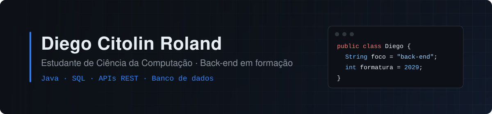

  

## Sobre mim

Sou estudante de Ciência da Computação na UNIP (4º semestre, conclusão prevista para 2029) e estou direcionando meus estudos para **desenvolvimento back-end**: Java, bancos de dados relacionais e construção de APIs.

Gosto de entender como os dados são modelados e como as camadas de uma aplicação conversam entre si. Hoje pratico isso em projetos acadêmicos com Java, JDBC e SQL Server, e estou começando a estudar Spring Boot para dar o próximo passo: APIs REST.

Procuro uma oportunidade de **estágio em desenvolvimento back-end**.

## Tecnologias

**Uso no dia a dia dos estudos**

  

Também trabalho com **SQL Server (T-SQL)**: views, stored procedures, functions e triggers.

**Estudando agora**

  

APIs REST e protocolo HTTP · Estruturas de Dados · Segurança da Informação · Inteligência Artificial

## Projeto em destaque

### [Sistema de Gestão para Academia de Artes Marciais](https://github.com/AguaBatizada/sistema-academia-artes-marciais)

Aplicação desktop em Java (Swing) com SQL Server para gerenciar alunos, modalidades e matrículas. Desenvolvida em grupo na UNIP.

- Arquitetura em camadas (MVC + DAO) com JDBC e `PreparedStatement`
- Modelagem relacional com relação N:N, views, procedures, functions e triggers de auditoria
- Credenciais do banco lidas de variáveis de ambiente, fora do código
- Erros do banco tratados e exibidos na interface; compilação verificada por GitHub Actions

`Java` `Swing` `JDBC` `SQL Server` `T-SQL` `MVC` `DAO`

## Contato

  

